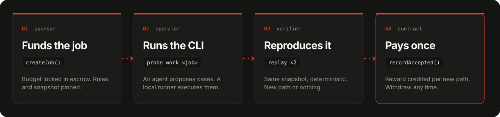
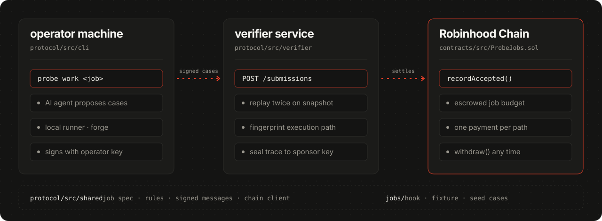

<p align="center">
  <a href="https://probecli.com"></a>
</p>

<p align="center">
  <a href="https://verifier.probecli.com"></a>
  <a href="https://robinhoodchain.blockscout.com/address/0x75a7af44fe0117b1f5ff11eddad11fe1e0d34189"></a>
  <a href="https://github.com/probecli/probe/actions/workflows/ci.yml"></a>
  <a href="https://github.com/probecli/probe/actions/workflows/bytecode.yml"></a>
  <a href="https://repo.sourcify.dev/4663/0x75a7af44fe0117b1f5ff11eddad11fe1e0d34189"></a>
  
  
  <a href="https://probecli.com"></a>
  <a href="https://x.com/probecli"></a>
</p>

<br>

**PROBE runs reproducible tests for Uniswap v4 hooks.** A hook team funds a job on-chain. Operators run the `probe` CLI, where an AI agent proposes test cases against a pinned chain snapshot. A deterministic verifier replays every case twice, and the contract pays once for each new execution path it reproduces.

This repository is everything that touches money or decides what gets paid: the escrow contract, the verifier, the operator CLI and the job specs. The website at [probecli.com](https://probecli.com) is a separate frontend that only reads from these.

<br>



## Quickstart

Needs Node 22.18 or later and [Foundry](https://getfoundry.sh).

```shell
git clone https://github.com/probecli/probe && cd probe/protocol
npm install && npm link
probe init            # creates your operator key; rewards are paid to its address
probe jobs            # funded jobs on the live verifier
probe work <job>      # run the job, submit the cases that pass
probe balance <job>
probe withdraw <job>
```

If `npm link` fails with a permissions error, use `alias probe="node $PWD/bin/probe.mjs"` instead. With `ANTHROPIC_API_KEY` set, the agent writes new cases for you; without it, the CLI runs the job's seed cases and any you add.



<sub>Output from a real CLI run on a local test chain with a test token (<code>npm run dev:stack</code>). Mainnet jobs pay in whatever the sponsor funded.</sub>

## How it fits together



| Path | What it does |
|---|---|
| [`contracts/src/ProbeJobs.sol`](contracts/src/ProbeJobs.sol) | Escrow. Pulls the full budget at creation, pays each path fingerprint once, refunds the rest after the deadline. |
| [`protocol/src/verifier/`](protocol/src/verifier) | HTTP service. Replays each case twice on the pinned snapshot, fingerprints its path, seals the trace to the sponsor, settles on-chain. |
| [`protocol/src/cli/`](protocol/src/cli) | The `probe` CLI for operators and sponsors. |
| [`protocol/src/shared/`](protocol/src/shared) | Job spec, acceptance rules, signed messages and chain client, used by both. |
| [`jobs/`](jobs) | Job specs: the hook, its fixture and seed cases. |
| [`deploy/`](deploy) | Docker Compose and Caddy config the public verifier runs with. |

### What gets paid

| Verdict | Meaning | Paid |
|---|---|---|
| ✓ Accepted | Reproduces twice on the snapshot, follows every rule, takes a path nobody was paid for | Yes, once |
| = Duplicate | Reproduces, but takes the same path as an accepted case | No |
| × Failed | Doesn't compile, doesn't reproduce, or breaks a rule (wall clock, network, file access) | No |

### Who can call what

| Role | Functions |
|---|---|
| Sponsor | `createJob`, `fund`, `close` (after the deadline, refunds what is left) |
| Verifier | `recordAccepted` (approved addresses only; reverts on a paid path, a closed job or an empty budget) |
| Operator | `withdraw` (everything owed, even after the job closes) |
| Owner | `setVerifier`, two-step `transferOwnership`. No power over job budgets. |

## Live deployment

| | |
|---|---|
| Network | Robinhood Chain mainnet, chain id `4663` |
| ProbeJobs | [`0x75a7af44fe0117b1f5ff11eddad11fe1e0d34189`](https://robinhoodchain.blockscout.com/address/0x75a7af44fe0117b1f5ff11eddad11fe1e0d34189) |
| Verifier | [`verifier.probecli.com`](https://verifier.probecli.com) · `0xd3c30efc0b0867963193c1d2dfd9fe31a442d746` |
| Owner | `0xfdbf67fbf0d089212189d9b35546962100a0b764` |
| Source | [Verified on Sourcify](https://repo.sourcify.dev/4663/0x75a7af44fe0117b1f5ff11eddad11fe1e0d34189), exact match |
| First paid job | Job 1 funded with 0.002 ETH ([tx](https://robinhoodchain.blockscout.com/tx/0xeb8b6baaeca17c008e19fbaf96dfa528b1a0b2157381a6b83c20c20da33a38f1)); one case accepted and paid 0.0002 ETH ([tx](https://robinhoodchain.blockscout.com/tx/0x1bd71402396b9c4ddb6e01a023c4f8b0ca9da0c4864a60551e65f951371c08f0)); operator withdrew it ([tx](https://robinhoodchain.blockscout.com/tx/0x3cff2fe1ddcdfb6541faf89cdd9d23b72dd995ca29593926c9d7ad1626d3f5b2)) |

Deployment, approval and first-job transactions: [`deployments/robinhood-chain.json`](deployments/robinhood-chain.json). The first job was funded by the PROBE team to run the full loop on mainnet; see it at [probecli.com/jobs/scheduled-exit-fee-withdrawals](https://probecli.com/jobs/scheduled-exit-fee-withdrawals).

### Verify the deployed contract

The bytecode on mainnet is built from [`contracts/`](contracts) with solc 0.8.26, optimizer at 200 runs, EVM cancun:

```shell
scripts/verify-bytecode.sh
# mainnet: 0x75a7af44fe0117b1f5ff11eddad11fe1e0d34189 matches contracts/ (5929 bytes)
# testnet: 0x75a7af44fe0117b1f5ff11eddad11fe1e0d34189 matches contracts/ (5929 bytes)
```

The script needs Foundry and `jq`. The [bytecode workflow](.github/workflows/bytecode.yml) runs the same check every day, so the badge above reflects what is on-chain today.

## Develop

```shell
cd contracts && forge test           # contract tests
cd protocol && npm test              # unit tests
cd protocol && npm run e2e           # full loop on a local chain: fund, run, verify, pay, withdraw
cd protocol && npm run dev:stack     # local chain + contract + verifier + a funded demo job
```

## Security

Cases are untrusted code. The verifier runs them as an unprivileged user with no shell, file or network access and none of the operator's environment. Failure traces can be working exploits, so they are encrypted to the sponsor's key and never published. See [SECURITY.md](SECURITY.md) for scope and how to report a vulnerability privately.

<br>

<p align="center"><sub><a href="https://probecli.com">probecli.com</a> · <a href="https://probecli.com/docs">Docs</a> · <a href="https://probecli.com/operators">Earn as an operator</a> · <a href="https://probecli.com/teams">Fund a job</a></sub></p>
